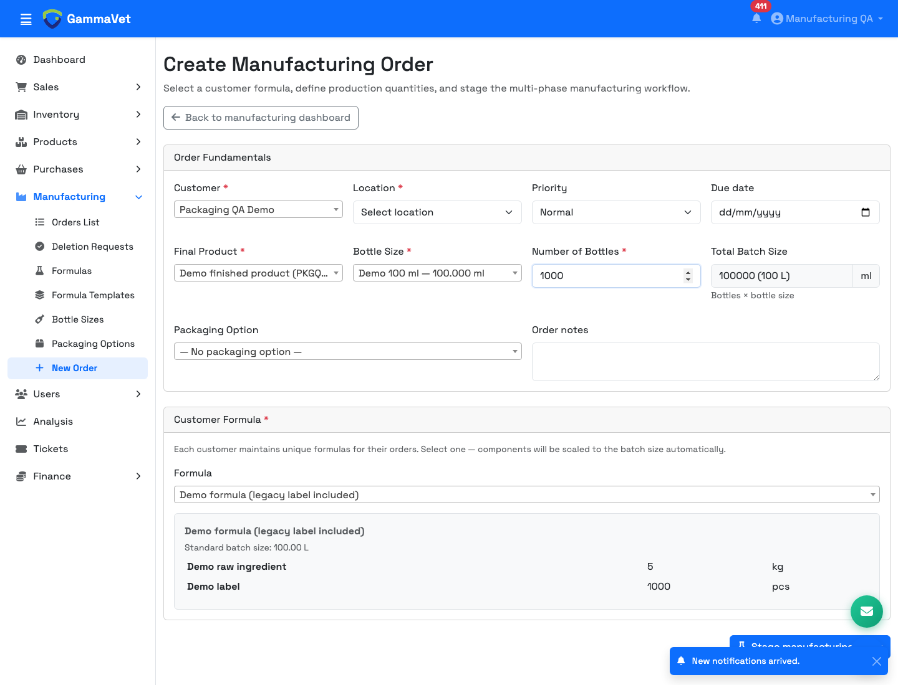
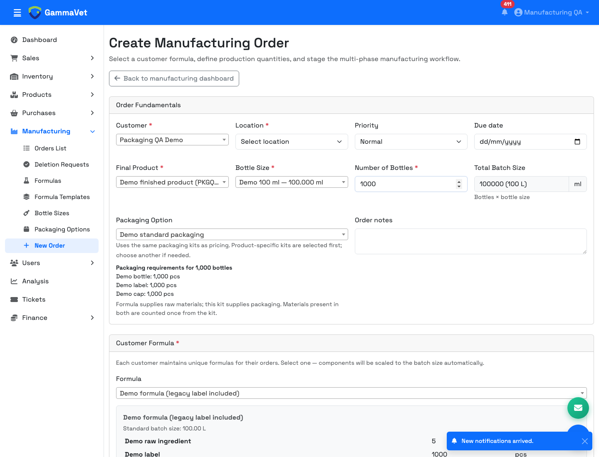
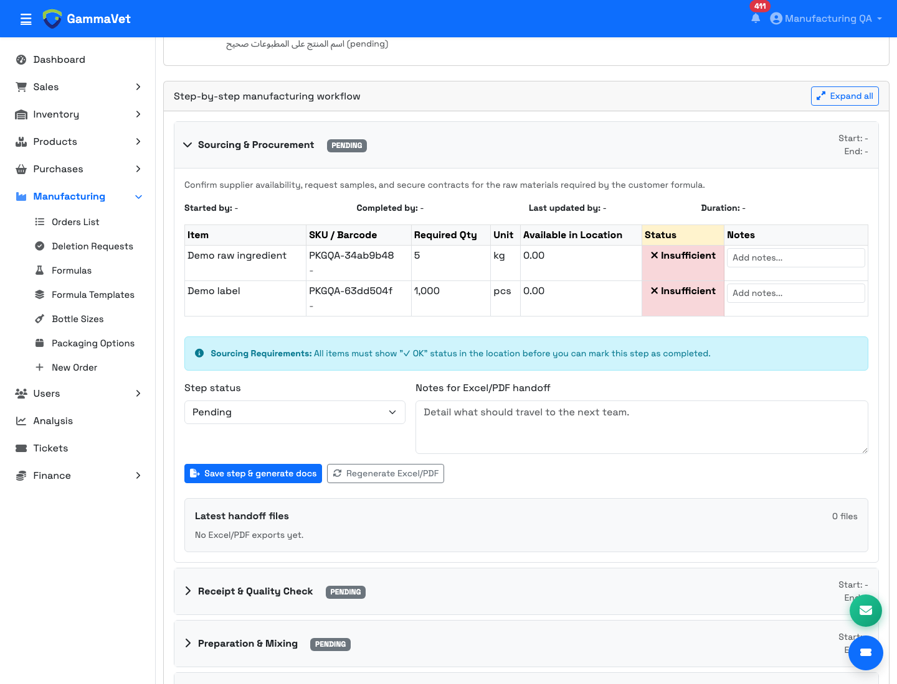
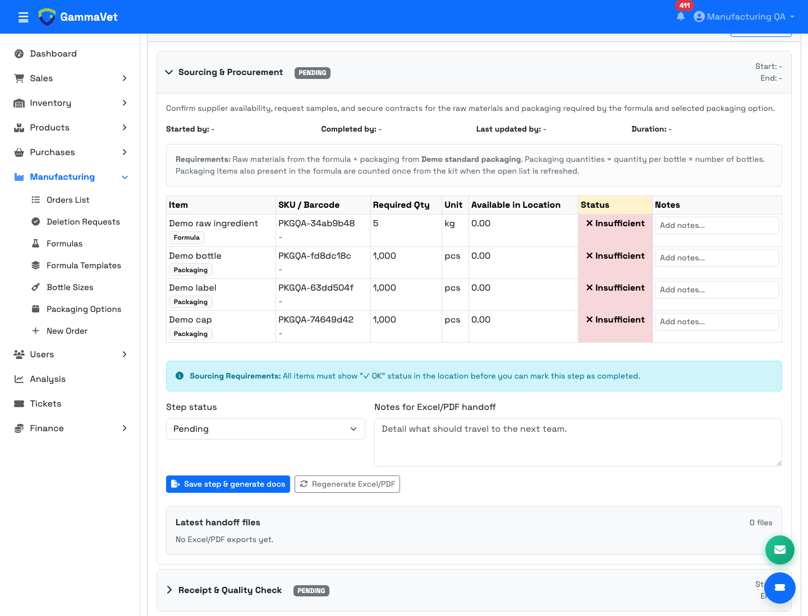

# Manufacturing: formula + packaging requirements

Date: 19 October 2026

## Client requirement

Use the formula for raw materials and the product's Packaging Option for bottles, caps, stoppers, stickers, boxes, leaflets, and other packaging. Maintain packaging once, for use by manufacturing and the approved pricing page.

## What changed

| Area | Before | After |
| --- | --- | --- |
| New order | Packaging defaulted to “No packaging option,” even when a kit existed. | The first active product-specific kit is selected automatically. Customer-wide kits follow, matching pricing's preference. Users can choose another available kit. |
| Packaging preview | No preview of the kit's requirements. | Lists materials and quantities, updating when the kit or bottle count changes. Empty kits and unavailable kits have explanatory messages. |
| Server-side creation | Packaging relied on the submitted selection. Initial raw-material scaling did not normalize formula/bottle units. | An omitted kit resolves to the same default on the server. Raw materials use the existing unit-aware manufacturing calculation from the start. |
| Existing open sourcing | Refreshed formula items only; missing packaging rows stayed missing. | Refreshes formula and selected packaging together, including added/removed kit materials. Saves a default kit on eligible open orders that have a bottle count but no selected kit. |
| Duplicate materials | A material in both formula and kit could be added twice. | The selected kit supplies that material once, using its per-bottle quantity. Matching uses the material's product ID. Repeated rows within a source are combined by product and unit. |
| Sourcing display | No indication of each item's source. | Formula/Packaging badges, raw materials first, and a description of the selected kit and calculation. |
| Existing notes | Formula synchronization followed component positions. | Matches requirements by source, product, and unit so reordering does not move notes to another material. Carries legacy packaging notes across and retains distinct notes when duplicate rows merge. |
| Handoffs | Sourcing handoff used the formula-only component table. | Sourcing handoff HTML reads saved formula + packaging requirements, including quantities, sources, units, and notes. This feeds Excel/PDF generation and the sourcing section of the full report. |

The shared synchronization runs when an order is created, opened, or edited. It uses a transaction and locks the order and its requirements while reconciling them.

## Before and after screenshots

These are actual local application screenshots using a disposable demo customer/product. No stock was added to the demo, so **Insufficient** is expected; these images demonstrate requirements, not purchasing or stock receipt.

### New manufacturing order

**Before:** A valid linked kit exists, but the selector still defaults to no packaging.



**After:** The linked kit is selected automatically. For 1,000 bottles the preview shows 1,000 bottles, 1,000 labels, and 1,000 caps.



### Sourcing & Procurement

The demo order has a selected kit but initially has no saved packaging rows, reproducing the existing refresh gap. Its legacy formula also contains the label.

**Before:** Opening the order rebuilds only formula requirements: 5 kg raw ingredient and 1,000 labels. Bottle and cap requirements are missing.



**After:** The same order shows 5 kg raw ingredient plus 1,000 bottles, 1,000 labels, and 1,000 caps. The label appears once, sourced from packaging.



## Existing data and boundaries

- Completed/cancelled orders, completed sourcing steps, and lists containing deducted stock or approved receipts are not resynchronized. Their saved requirements remain intact.
- Legacy orders with a selected kit but no usable bottle count are preserved because packaging quantities cannot be safely inferred.
- If no active kit is available, formula materials remain usable and the creation form explains how to add packaging. Packaging is not guessed from material names.
- Existing formula definitions are not rewritten or deleted. Packaging should be entered in Packaging Options for new setups. Legacy formula overlaps are excluded from manufacturing requirements only when the selected kit contains the same material product ID; manual text-only entries cannot be matched this way.
- The approved pricing implementation and saved quotations are unchanged. Pricing still reads its formula data, so legacy packaging entries should be removed manually from formulas before preparing new quotations that would otherwise count them twice.
- Existing stock deduction, receipts, cancellation/restocking, and purchasing workflows continue to consume the saved sourcing rows. Refreshing requirements does not deduct stock.
- Existing generated documents are not rewritten; newly generated sourcing handoffs use the updated template.
- No new schema migration is required on the current database. The existing packaging migrations (`20260420_create_packaging_options.sql` and `20260518_packaging_option_product_and_custom_material.sql`) must already be applied.

## Files changed

- `modules/manufacturing/sourcing.php`: shared kit lookup, quantity construction, duplicate handling, protected synchronization, and sourcing handoff table.
- `modules/manufacturing/lib.php`: loads the shared helper, updates sourcing instructions, and includes combined requirements in sourcing handoffs.
- `modules/manufacturing/create.php`: automatic selection, live preview, active-kit validation, and shared creation calculation.
- `modules/manufacturing/order.php`: synchronizes both sources and displays the selected kit and item sources.
- `modules/manufacturing/edit.php`: replaces separate rescaling loops with the shared guarded calculation.
- `ajax/get_packaging_options.php`: returns kit items for previews and prioritizes product-specific kits.
- `tests/manufacturing_sourcing.php`: database regression checks with transaction rollback.
- This document and its four screenshots.

## Additional requirement: combined sourcing list

The client also requested one material list across manufacturing orders so shared materials can be prepared together. This is now available at **Manufacturing → Sourcing & Procurement**, with a second entry point on the manufacturing orders page.

- Displays one line per material and compatible unit, showing total required quantity, source, and order count.
- Expands each material into its order/customer, final product, location, and quantity breakdown, with links to the orders.
- Supports customer, location, material-source, and material name/SKU/barcode filters.
- Includes raw materials and packaging from orders whose sourcing is not completed; excludes completed/cancelled orders and already deducted or approved-received rows.
- Uses the same calculation as individual orders without changing orders, sourcing rows, or stock. Orders do not need to be opened individually before they contribute to the list.
- For lists already containing deducted/approved rows, uses the saved outstanding rows. Legacy kit orders without bottle counts also use saved requirements and are flagged for review.
- Converts grams to kilograms, millilitres to litres, and common piece-unit aliases to pieces. Incompatible units remain separate. Unlinked text-only formula items are listed separately rather than merged by name.
- Flags missing bottle counts, missing packaging, empty kits, or empty formulas so an incomplete setup is visible.
- Requires both manufacturing view and sourcing-step view permissions, restricts access to Factory, respects customer/salesperson scope, and hides material names when the user lacks component-name permission. Hidden names cannot be discovered through material search.

This is a requirements planning view. It does not calculate purchase shortages, create purchase orders, reserve stock, or distribute materials.

Additional files: `modules/manufacturing/sourcing_list.php` (page), `modules/manufacturing/sourcing_planning.php` (aggregation), `includes/header.php` (navigation), and `modules/manufacturing/index.php` (entry point). `modules/manufacturing/sourcing.php` now exposes the shared read-only calculation used by both synchronization and planning. The regression test and client proposal have also been updated.

The disposable planning fixtures were removed after verification. Three further screenshots document the previous orders list, combined sourcing totals, and expanded order breakdown. All are included in `manufacturing_packaging_proposal.md`.

Validation passed for combined kg/g totals, shared packaging, untouched orders contributing without writes, location/search/source filters, empty results, hidden-name search, incompatible units, completed/cancelled/sourced exclusions, deducted/received exclusions, and cross-company scope. Browser checks confirmed three demo orders total **60 kg MPG** (25 + 30 + 5) and **3,500 bottles/caps**, with working breakdowns and filters and no PHP/JavaScript errors.

## Validation

PHP syntax checks passed for every changed PHP file. `git diff --check` passed.

The integration checks cover:

- Product-specific kit preference, customer-wide fallback availability, inactive-kit exclusion, and product isolation.
- 100 L formula versus 1,000 × 100 ml production: 5 kg raw material and 1,000 of each packaging item.
- Legacy label overlap counted once, and its sourcing note transferred.
- Orders without kits retaining formula materials.
- Sourcing handoff containing both sources and respecting hidden component names.
- Repeat refresh preserving row IDs, notes, and timestamps.
- Production changes scaling raw materials and packaging independently.
- Kit changes removing stale requirements without shifting notes.
- Completed/cancelled orders, completed sourcing, approved receipts, deducted requirements, and legacy kit orders without bottle counts remaining unchanged.

Run the regression checks against the configured local database:

```sh
docker compose exec -T -e GAMMAVET_MANUFACTURING_TEST=1 app php tests/manufacturing_sourcing.php
```

The test inserts its own temporary records inside a transaction and rolls them back in `finally`. It requires an existing category in the local database.

Headless-browser checks also passed for automatic kit selection, preview updates at 2,000 bottles, real order creation with the kit field omitted, combined sourcing without a duplicate label, invalid-kit rejection, and absence of PHP/JavaScript errors on those flows.

The screenshots were visually reviewed. Screenshot fixtures and the browser-created demo order were removed after verification; the PNGs remain as documentation. Actual PDF/Excel file generation was not exercised; the shared handoff HTML was checked.
