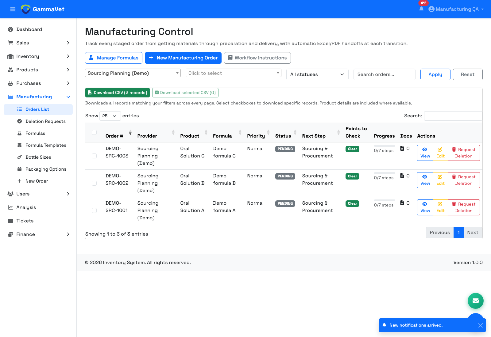
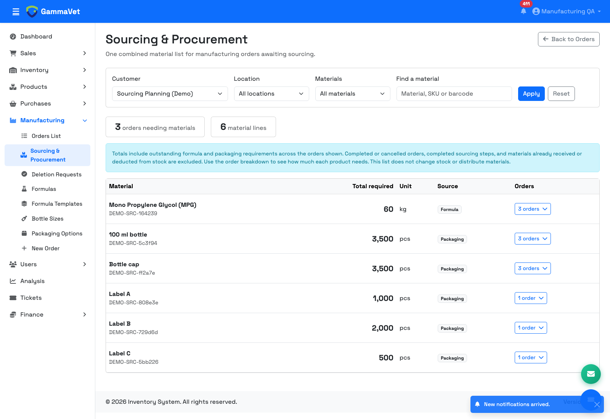
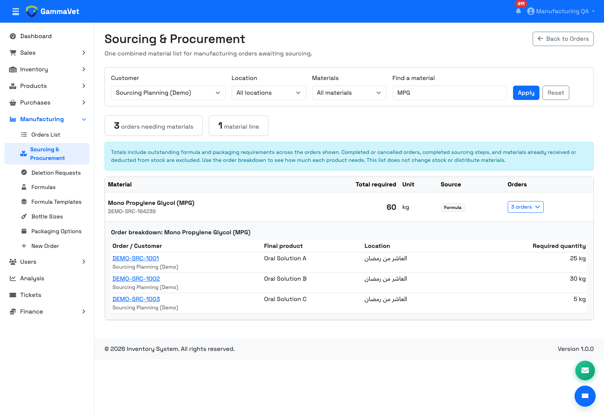

# Manufacturing – Proposal

## What we will do

We will update **Sourcing & Procurement** to bring together the product's raw materials and packaging, using the same packaging setup as the approved pricing page.

- **Raw materials** come from the formula.
- **Packaging materials** come from the product's Packaging Option.

You enter the packaging once, and the system uses it for both manufacturing quantities and pricing. There is no need to enter stickers, boxes, leaflets, bottles, stoppers, or caps again inside the formula.

We will also add **one combined sourcing list for all manufacturing orders awaiting materials**, so the sourcing team can see the total needed of each material without opening every order.

> The screenshots below use **demo data**, not real customer orders. No stock was added to the demo, so individual order checks show “Insufficient.”

## Step 1 – Create the manufacturing order

Choose the customer, product, formula, bottle size, and number of bottles.

The system will select the product's packaging option automatically. If there is more than one option, you can choose the one needed for this order.

Under the selection, you will see the packaging materials and quantities needed. These quantities update when you change the number of bottles or the packaging option.

**Before:** Packaging could remain unselected even when the product had a packaging option.

**Proposed:** Packaging is selected automatically, with its required quantities shown underneath.

## Step 2 – Sourcing & Procurement

This step will show both groups together:

- Raw materials, calculated from the formula and the production quantity.
- Packaging materials, calculated from the selected packaging option and the number of bottles.

Each item will be marked **Formula** or **Packaging**. The system will compare the required quantity with the stock available at the manufacturing location.

**Before:** Refreshing an order could bring in formula items while leaving out packaging materials.

**Proposed:** Sourcing includes the raw materials and the full selected packaging list.

## Example

For **1,000 bottles of 100 ml**, using a formula for **100 litres**:

| Item | Taken from | Required quantity |
| --- | --- | ---: |
| Raw ingredient | Formula | 5 kg |
| Bottle | Packaging Option | 1,000 pieces |
| Label | Packaging Option | 1,000 pieces |
| Cap | Packaging Option | 1,000 pieces |

If the same label is still entered in an old formula, manufacturing will count it **once**, using the packaging option's quantity.

## Step 3 – One sourcing list for all orders

Open **Manufacturing → Sourcing & Procurement** from the side menu, or use the button on the manufacturing orders page.

Instead of checking each order separately, you will see a combined list showing:

- Each raw material or packaging item.
- The **total quantity required** across the orders awaiting sourcing.
- Its unit and how many orders need it.

Common materials will be added together. For example, if three orders need **25 kg, 30 kg, and 5 kg of Mono Propylene Glycol**, the list will show **60 kg** in one line.

**Before:** The manufacturing page lists the orders, and you have to open each order to check its material requirements.

**Proposed:** One list brings together the requirements for all these orders, including shared packaging.

Click the **orders** button beside a material to see how the total is divided between orders. You can open any order from this breakdown.

You can filter by **customer**, **location**, or **raw materials/packaging**, and search for a material by its name, SKU, or barcode.

The list will include outstanding requirements only. Completed or cancelled orders, completed sourcing steps, and materials already received or deducted from stock will be excluded. Grams and kilograms, or millilitres and litres, will be combined using compatible units.

This gives the sourcing team the quantities to prepare together. Physically distributing materials between orders will continue separately; viewing the list will not change stock.

## Existing orders and reports

- Open sourcing lists will update to include both raw materials and packaging while keeping their notes.
- Completed orders and requirements already deducted from stock or approved as received will keep their saved quantities.
- Newly generated sourcing handoff reports will include both groups.
- The approved pricing screen will continue to use the same Packaging Options.

For future setup, keep raw materials in the formula and all packaging in Packaging Options.

## Approval

Please review the proposed flow and screenshots. You can **approve it as shown** or send any changes you would like us to make.
