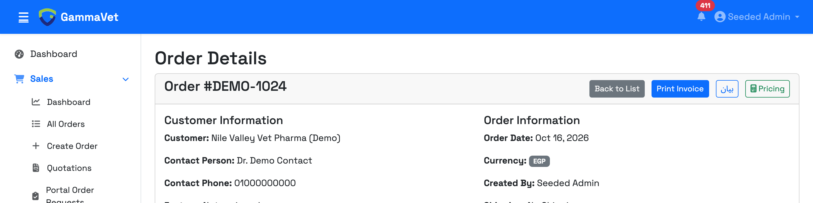
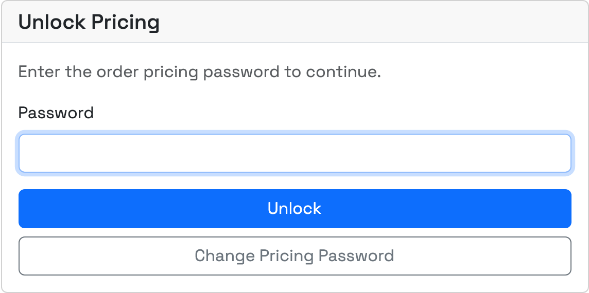
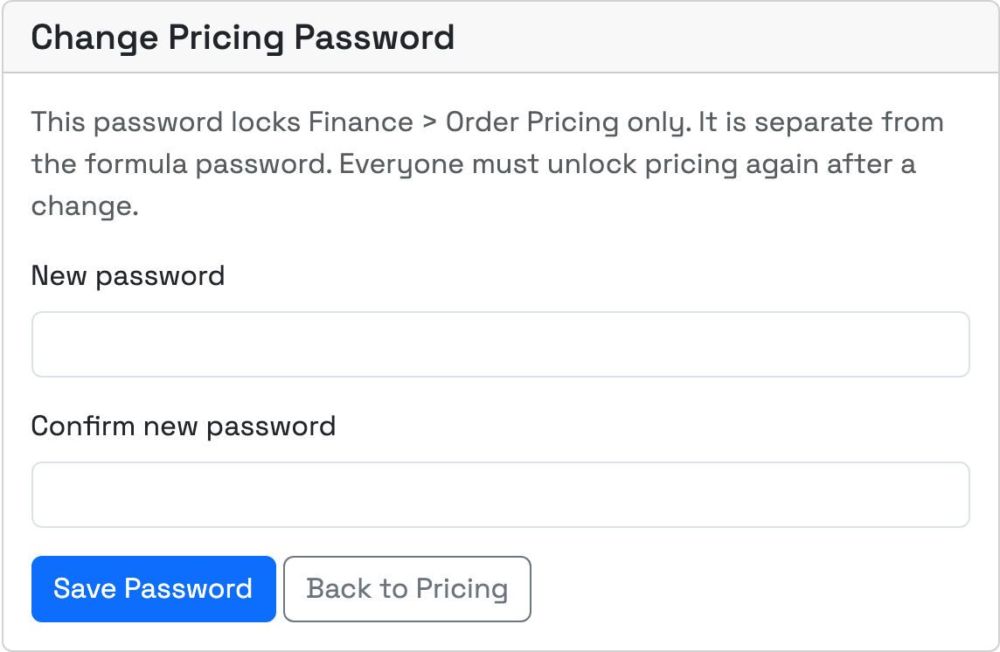
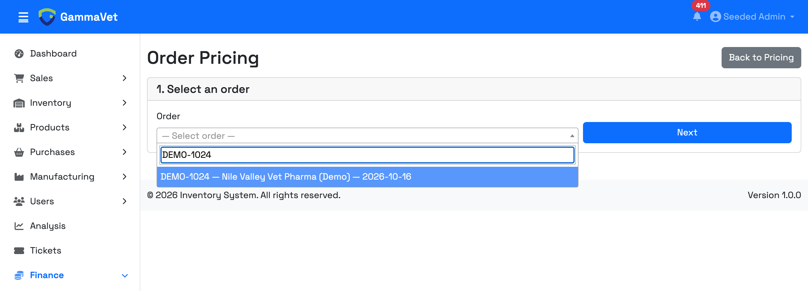
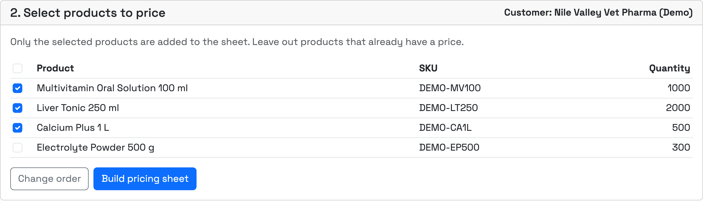
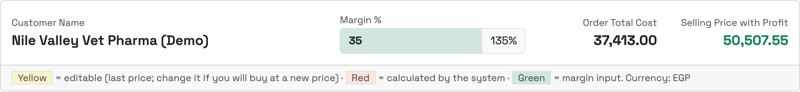
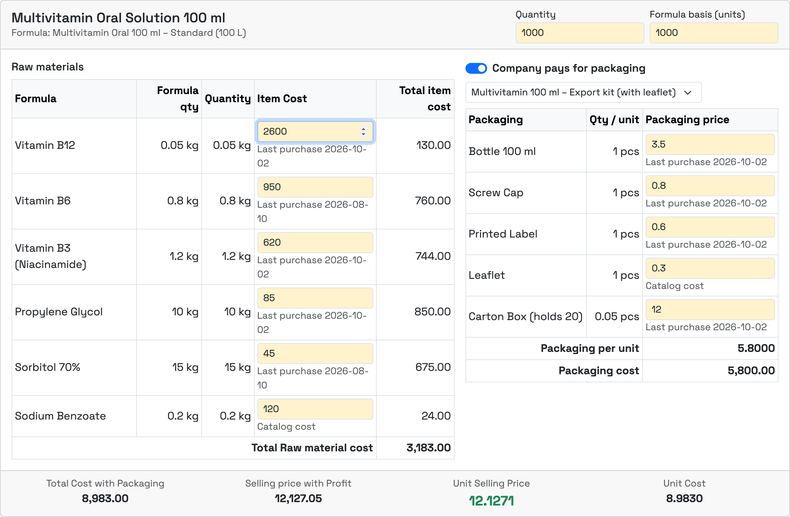
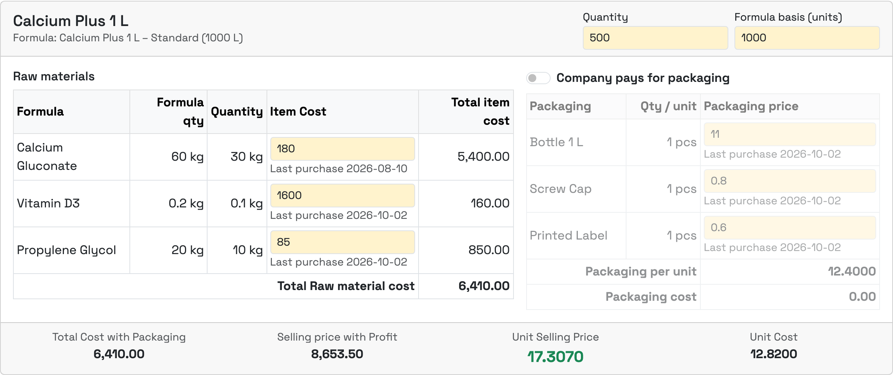
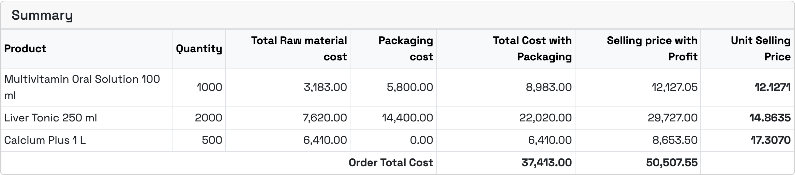
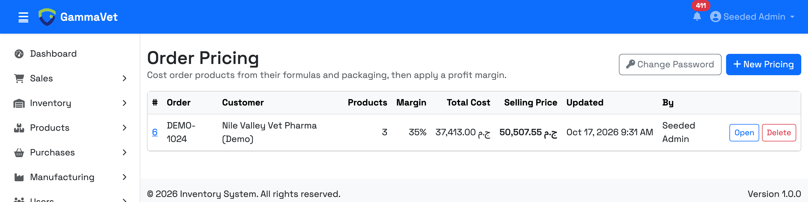

# Order Pricing – Proposal

## What we will do

We will add a pricing screen to the system that works like your Excel pricing sheet. It calculates the selling price of the products in an order from their formulas, packaging, and your profit margin.

> The screenshots below use **demo data** (customer "Nile Valley Vet Pharma (Demo)", order DEMO-1024). They are not real orders or prices.

## Where to find it

- **Finance → Order Pricing** in the side menu.
- A **Pricing** button on every order page.

## Password protection

The pricing screen is locked with its **own password**, separate from the formulas password. Everyone must enter it before they can see any prices.

- Only admins can change the password, using the **Change Password** button.
- After a change, everyone has to enter the new password again.

Access is given per role:

- **View**: can open saved pricing sheets but cannot change anything.
- **Create and edit**: can make new pricing sheets, change them, and delete them.

## Step 1 – Choose the order

Search for the order by its number or the customer name.

## Step 2 – Choose the products to price

All products in the order are listed with their quantities. Tick only the ones you want to price, and leave out products that already have a price.

In this example, the order has 4 products. Electrolyte Powder already has a price, so only the other 3 are ticked.

## Step 3 – The pricing sheet

At the top: the customer name, the profit margin, the order total cost and the total selling price. They all update instantly as you change anything.

The colours are the same as your Excel sheet:

- **Yellow**: values you can change
- **Red**: totals calculated by the system
- **Green**: the profit margin

### Raw materials

For each product, the system brings its formula automatically:

- Every raw material with its quantity in the formula.
- The **quantity needed for this order**. Formulas are made for 1,000 pieces, so 500 pieces use half the materials and 2,000 pieces use double.
- The **latest price** of each material, taken from the most recent purchase. The date of that purchase is shown under the price. If a material was never purchased, the price saved on the product is used.
- You can change any price (yellow box) if you will buy at a new price. In the example, Vitamin B12 was changed to 2,600.
- You can also change the order quantity, or the formula size if a formula is not made for 1,000 pieces.

### Packaging

- A switch **"Company pays for packaging"** for each product. Turn it on when the company pays, and off when the customer sends their own packaging.
- When it is on, the system brings the product's packaging items (bottle, cap, label, box…) with the quantity per bottle and their latest prices.
- If a product has more than one packaging option (for example "Local" and "Export"), you choose one from a list.
- Packaging cost = packaging cost per bottle × number of bottles.

Example with packaging on:

Example with packaging off (the customer supplies the bottles):

Under each product you see:

- Total cost with packaging
- Selling price with profit
- **Unit selling price** (price per piece)
- Unit cost (cost per piece)

### Summary

At the bottom, a summary of all the products in the order and the order totals:

## How the price is calculated

Example from the screenshots: Multivitamin Oral Solution 100 ml, 1,000 bottles, margin 35%.

| Step | Calculation | Amount (EGP) |
|---|---|---:|
| Raw materials | each material quantity × its price, added together | 3,183.00 |
| Packaging | 5.80 per bottle × 1,000 bottles | 5,800.00 |
| Total cost | 3,183 + 5,800 | 8,983.00 |
| Selling price | 8,983 × 135% | 12,127.05 |
| **Price per piece** | 12,127.05 ÷ 1,000 | **12.1271** |

## Saving and history

- Add notes to the pricing sheet (for example "Quote for Q4 order") and save it.
- All saved pricing sheets are listed with the order, customer, margin, total cost, selling price, date, and who made them.
- Open a saved sheet any time to review it, change it, or delete it.
- A saved sheet keeps the prices that were used at that time, even if material prices change later.
- Pricing does not change the prices on the order itself. It is used to calculate and decide the price.

## Next step

We finalise the screen and show you a short demo on your real orders.
